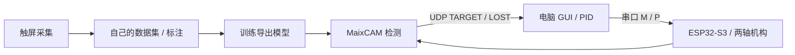

# MaixCAM 视觉追踪与数据采集

MaixPy / YOLOv5 / UDP / Python / PID

[现场演示与项目介绍](https://dgwfpga.cn/showcase/maixcam-tracking.html) · [地瓜丸的 FPGA 教学平台](https://dgwfpga.cn/) · [验证范围](VALIDATION.md)


从触屏采图、标注和训练，到识别坐标发送、电脑 PID 与执行机构，整理成两条可以分别上手的路径。



## 两个入口

| 目录 | 包含什么 |
| --- | --- |
| `dataset-and-training` | 触屏拍照、识别脚本，以及采集、标注、训练和部署教程 |
| `tracking` | MaixCAM 检测／UDP 发送、电脑 GUI、接线与 PID 调试说明 |

先阅读 [采集与训练入口](dataset-and-training/README.md)，或直接进入 [追踪入口](tracking/README.md)。

## 快速验证软件链

```powershell
pip install -r requirements.txt
python tracking/pc端GUI/GUI.py
```

先保持 GUI 的 `dry-run`，启动 UDP 监听，只观察坐标和命令。相机端 `PC_IP` 已改为文档示例值 `192.0.2.10`，使用前替换为自己电脑在同一网络的地址。只有确认通信和方向后才连接执行机构。

ESP32 执行固件参见 [鼠标双轴云台仓库](https://github.com/bvsdehdshfbs300-debug/dgw-mouse-gimbal/tree/main/esp32)，使用其中能接收 `M x y` 和 `P us` 的 ESP-IDF 实现，先核对两端协议。

## 关于模型与数据

本仓库开源代码与教程，不含拍摄数据集或训练权重。教程里的 `model_280927` 是原工程示例名称，须从自己的训练任务导出 `.mud` 和 `.cvimodel` 后部署，或同步修改脚本路径。演示中的玩偶只用于说明目标检测流程，不随项目提供素材包。

MaixCAM Pro 与 MaixCAM2 使用条件分别确认。本项目的采集和追踪代码使用 MaixPy 平台接口，不能作为普通桌面 Python 程序直接运行相机部分。


## 许可与贡献

项目代码按 [MIT](LICENSE) 发布，依赖与原始署名见 [NOTICE.md](NOTICE.md)。欢迎附上所用硬件、固件／工具版本、复现步骤和日志提出问题；请先去除自己的网络密码和设备信息。
